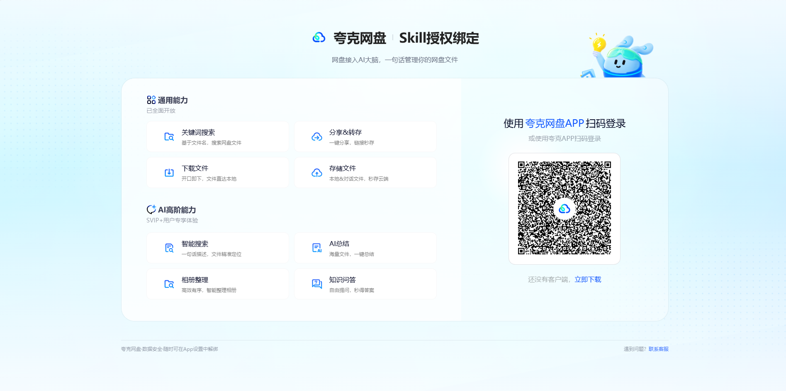
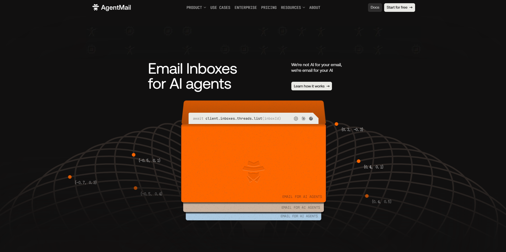

# 工具链接入实操：夸克网盘 + AI 邮箱

> 这两条通道解决同一个问题：**她不能只活在自己的容器里**。
> 外面的东西要能进来（工程文档、用户诉求），里面的产出要能出去（备份、分享）。

---

## 一、为什么要外接

她的运行环境是一台云端 Linux。它能访问 B 站 API、能调外部视觉模型，但：

| 缺什么 | 后果 |
|---|---|
| 不能读你电脑上的文件 | 你写的工程文档进不来 |
| 没有持久的大容量存储 | 视频、模型备份不了 |
| 发不出邮件 | 产出无法交给外部 |

所以接两条：

```
本地 ──邮件──→ 云端          （工程文档、日报、知识）
本地 ──网盘──→ 云端          （视频、模型、大备份）
```

---

## 二、夸克网盘

### 2.1 授权（关键：环境标识）

夸克官方 CLI 会检测「Agent 环境」，不认识就直接拒绝：

```json
{"code":-104,"msg":"无法识别当前 Agent 环境，禁止继续使用"}
```

**解决办法：设置环境变量 `OPENCLAW_CLI=1`。**

```bash
export OPENCLAW_CLI=1
node scripts/quark-drive.cjs login
```

之后它会给出一个授权链接：



打开链接、用夸克 App 扫码确认，会得到一个授权码（形如 `AAC-xxxx`）。
拿授权码完成登录：

```bash
node scripts/quark-drive.cjs login --token "AAC-xxxxxxxx"
```

成功返回：

```json
{"code":0,"msg":"成功","data":{"status":"confirmed","msg":"授权登录成功"}}
```

> ⚠️ **授权页显示的设备名是服务器名**（如 `Alibaba Cloud ECS`），不是你的电脑。
> 授权等于把网盘读写权交给那台服务器，扫码前确认清楚。

### 2.2 安装踩坑：zip 包套了一层

官方 `install.sh` 解压后，文件落在 `scripts/scripts/` 里，自检会报：

```
[error] CLI 入口文件不存在: .../scripts/quark-drive.cjs
```

手动提一层：

```bash
cp -rf scripts/scripts/* scripts/ && rm -rf scripts/scripts
node scripts/quark-drive.cjs --version   # 1.0.25-876f30d
```

### 2.3 分享：永久 + 无提取码

```bash
node scripts/quark-drive.cjs share "<FID>" \
  --title "标题" \
  --url-type 1 \
  --expired-type 1
```

| 参数 | 值 | 含义 |
|---|---|---|
| `--url-type` | `1` | 公开链接（无提取码） |
| `--expired-type` | `1` | 永久有效 |

实测返回：

```json
{"code":0,"data":{"share_url":"https://pan.quark.cn/s/xxxxxxxx","url_type":1,"expired_type":1}}
```

### 2.4 实测数据

| 操作 | 结果 |
|---|---|
| 安装 | 1 秒（下载 1.0.25 包） |
| 授权 | 授权码方式，秒级确认 |
| 列目录 | 7 项，约 1 秒 |
| 上传 16.9KB | 秒级，落在 `来自：OpenClaw` |
| 分享 | 秒级，返回永久公开链接 |

### 2.5 内存代价

CLI 是 Node 程序，峰值 RSS 约 **61 MB**。
在一台 available 只剩 731MB 的机器上能跑，但要注意别和其他重任务叠加。

---

## 三、AI 邮箱

### 3.1 两个邮箱，各管一头

| 地址 | 名字 | 谁用 | 用途 |
|---|---|---|---|
| `local-agent@agentsend.io` | LOCAL AI AGENT | 本地 | 发工程文档、日报 |
| `anthropos@agentsend.io` | Anthropos | 云端 | 收件、归档、按需回复 |

分工的理由：**发件人和收件人分开**，云端一眼就能看出「这封是本地来的」还是「外部别人发的」。



> 图里是 **AgentMail**（agentmail.to），和本项目实际使用的 **AgentSend**（agentsend.io）是同类服务、不同厂商。
> 这类服务的共同点：给 AI 一个真实地址，收发走 HTTP API，不需要 IMAP。

### 3.2 实测

| 项 | 结果 |
|---|---|
| 发信 | `202 queued` |
| 到达 | **2 秒**（同机房） |
| 云端读信 | 服务器直连 TTFB 1.9 秒 |
| 日限额 | 10 封/收件箱 |
| 附件 | 支持，但工程文档建议正文直出 |

### 3.3 邮件里不许出现什么

邮件出了容器就不可控。发布前必须过滤：

| 禁止 | 原因 |
|---|---|
| 服务器 IP / 端口 | 直接暴露攻击面 |
| 密码 / token / Cookie | 泄露即失守 |
| 主人 UID、真实昵称 | 隐私 |
| 内部绝对路径里的用户名 | 可推断环境 |

**做法**：发送前跑一遍正则黑名单，命中就拒发并报警，而不是"过滤掉继续发"——因为被过滤的内容往往是整段上下文，删了反而语义错乱。

---

## 四、踩坑汇总

| # | 坑 | 现象 | 修法 |
|---|---|---|---|
| 1 | 夸克 CLI 不认服务器 | `code:-104 无法识别当前 Agent 环境` | `export OPENCLAW_CLI=1` |
| 2 | zip 包多套一层目录 | 自检报入口文件不存在 | `cp -rf scripts/scripts/* scripts/` |
| 3 | 以为 `r=mp4` 能传视频 | 返回 5633 字节 HTML 404，像域名被封 | 参数必须是 `r=upos` |
| 4 | 用 `vipStatus` 判断实名 | 它是大会员标志，永远 0 | 直接看 `preupload` 返回 `OK=1` 还是 `601` |
| 5 | 邮箱地址想当然 | 自定义地址可能被占用 | 创建时检查返回的 `id`，失败就换名 |
| 6 | 把 AgentMail 当成 AgentSend | 两家不同厂商，API 不通用 | 认准实际用的那家 |

---

## 五、这两条通道对项目的意义

工程文档自动流进来之后，她第一次有了**跨天连续的知识**：

- 昨天做过什么、实测数字是多少、踩过哪些坑 —— 都在 `knowledge/projects/`
- 被问到技术问题，她能答具体的，而不是"我理解你的需求"
- 做视频选题时，知道自己**能**做什么

而这套东西的价值不在技术复杂度，在于**它是闭环的**：

```
做完 → 写下来 → 送出去 → 收回来 → 变成明天的能力
```

大部分"AI 角色"项目死在这一步：记忆只存在当前会话里，换个会话就归零。
